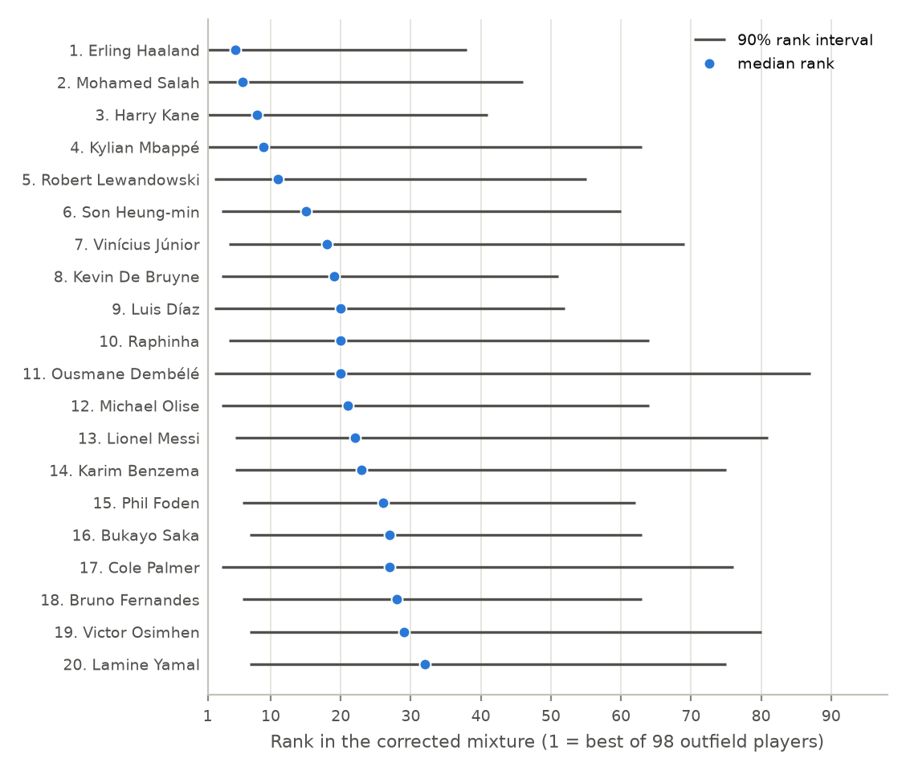
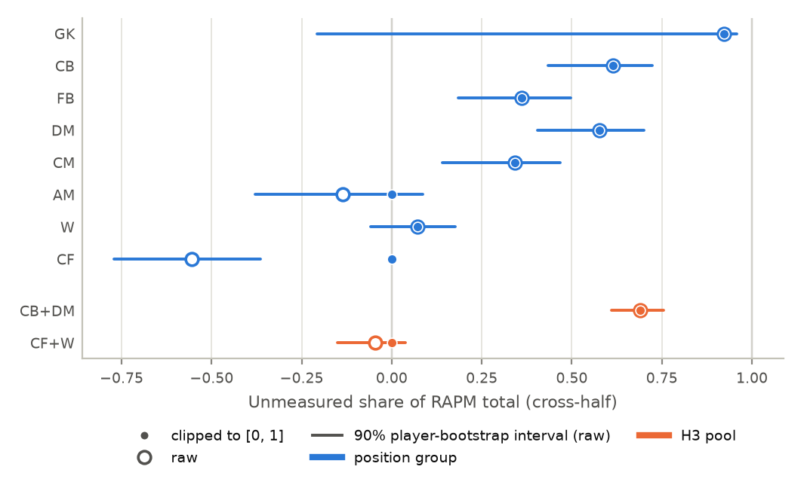
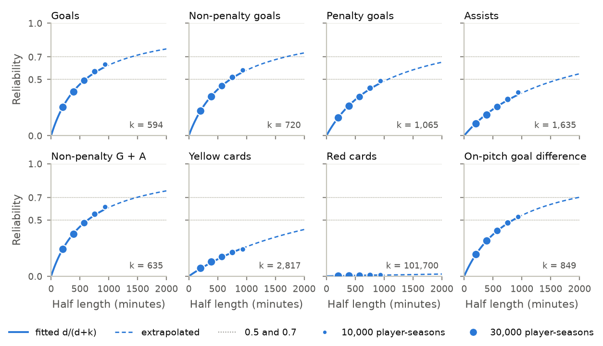
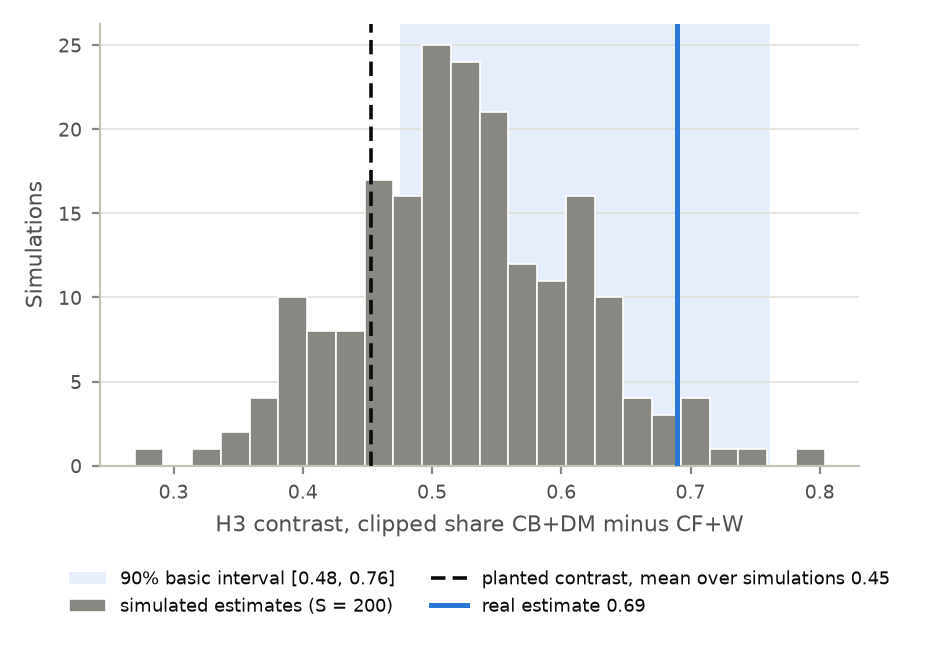
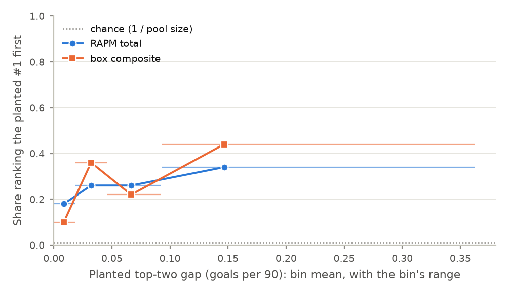
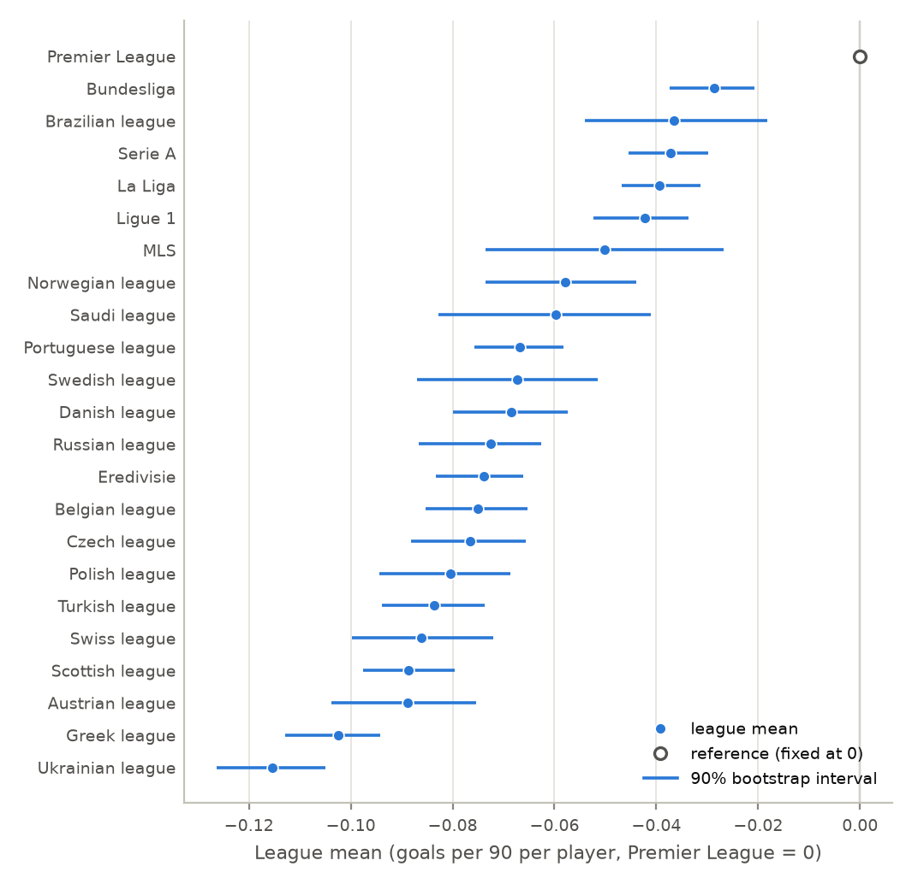
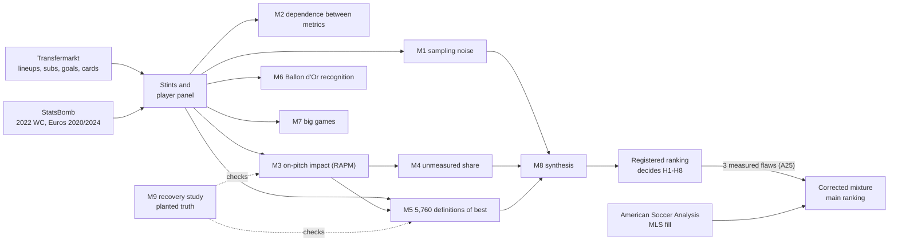

# The Unmeasured Remainder

[](https://github.com/Bardakor/The-Unmeasured-Remainder/actions/workflows/verify.yml)
[](paper-unmeasured/preregistration.md)
[](The-Unmeasured-Remainder.pdf)
[](pyproject.toml)
[](LICENSE)

**How much of "who was the best footballer of 2020–2026" can public match data decide, and
how much of what happens on the pitch do the statistics not reach?**

A pre-registered, reproducible study of **45,035 matches** and **65,445 players** from
1 January 2020 to 31 August 2026. It starts from a 48-player ranking written by another AI
model and rebuilds every player estimate from raw data, for a pool of 106 players fixed
before any result: those 48 and every player ranked in a Ballon d'Or from 2021 to 2026.

**[Read the paper (PDF)](The-Unmeasured-Remainder.pdf)** ·
[Pre-registration](paper-unmeasured/preregistration.md) ·
[Study design](docs/superpowers/specs/2026-11-14-unmeasured-remainder-design.md) ·
[Cite](#citation)

## The answer in five lines

| Question | Answer |
|---|---|
| Who leads? | **Erling Haaland**, median rank 5 of 98 outfield players. |
| Is he clearly the best? | **No.** Probability of being ranked first: 0.18. His 90% rank interval runs from 1 to 38. |
| How much of the ranking is decided? | **11%** of outfield pairs at the 0.9 level, and **no pair** among the first ten places. |
| What does the ranking measure? | **Attacking production.** 96% of its weight is on definitions that contain goals and assists; its first twenty places all go to forwards, wingers and attacking midfielders. |
| What do the statistics miss? | For centre-backs and defensive midfielders, **69%** of their on-pitch impact (90% interval 48% to 76%). For forwards and wingers, close to none. |

## 1. The ranking, with its uncertainty



*Each dot is a player's median rank and each line his 90% rank interval, over 5,760
definitions of "best", 200 match-bootstrap replicates of the data, and draws of the part of
impact the statistics cannot see and of the part of RAPM that belongs to teammates. Where
lines overlap, the data cannot order the players.*

| Place | Player | Median rank | 90% interval | P(#1) | P(top 3) |
|---:|---|---:|:---:|---:|---:|
| 1 | Erling Haaland | 5 | [1, 38] | 0.18 | 0.38 |
| 2 | Mohamed Salah | 6 | [1, 46] | 0.11 | 0.30 |
| 3 | Harry Kane | 8 | [1, 41] | 0.08 | 0.25 |
| 4 | Kylian Mbappé | 9 | [1, 63] | 0.06 | 0.22 |
| 5 | Robert Lewandowski | 11 | [2, 55] | 0.04 | 0.16 |

The same five players hold the first five places under each of three sensitivities: equal
weights, no teammate-contamination term, and a second estimate of that contamination. The
first centre-back is 64th. That place is not evidence that he was worse; see section 2.

> [!IMPORTANT]
> **This ranking is post hoc.** The pre-registered analysis decides the hypotheses and is
> reported in full in the paper (Section 7). Its ranking put Luis Díaz first, but three
> measured flaws of the method produced its leaders ([section 5](#5-what-went-wrong-in-the-registered-ranking)).
> The corrected mixture was fixed in writing (amendment A25) before it was computed, and the
> paper reports whatever came out of it.

## 2. The unmeasured remainder



*Share of a player's true on-pitch impact (RAPM, goals per 90) that his goals, penalty goals,
assists and cards cannot predict, by position group, corrected for the noise in both sides.
Dots are clipped to [0, 1]; open circles are raw values; lines are 90% player-bootstrap
intervals.*

| Group | CB | DM | FB | CM | W | AM | CF | GK |
|---|---:|---:|---:|---:|---:|---:|---:|---:|
| Unmeasured share | 0.61 | 0.58 | 0.36 | 0.34 | 0.07 | 0.00 | 0.00 | 0.92* |

\* The goalkeeper interval runs from 0 to 0.96: the data cannot say.

For a striker, the box score is nearly the whole story. For a centre-back it is less than
half. A ranking built on these statistics can therefore rank attackers, and cannot rank
defenders against them.

## 3. The eight pre-registered hypotheses

Written and committed ([`4e174b3`](https://github.com/Bardakor/The-Unmeasured-Remainder/commit/4e174b3),
14 November 2026) before any player-level number existed. Each has a refutation rule fixed
in advance; all are decided by the registered analysis.

| | Hypothesis | Refuted if | Observed | Verdict |
|---|---|---|---|---|
| H1 | Most of the ranking is undecided | ≥ 50% of outfield pairs decided at 0.9 | 14% decided | **supported** |
| H2 | No consensus number one | some outfield P(#1) ≥ 0.5 | highest 0.17 | **supported** |
| H3 | The unmeasured share is larger for CB+DM than for CF+W | 90% interval of the difference includes 0 | 0.69 [0.48, 0.76] | **supported** |
| H4 | Modelling choices outweigh sampling noise | mean variance ratio ≤ 1 | 1.13 | **supported** |
| H5 | Time aggregation is the decisive definitional choice | another dimension matters more | aggregation 0.10; metric family 0.82 | **refuted** |
| H6 | Ballon d'Or recognition follows team success more than statistics | team share ≤ statistics share | team 0.15, statistics 0.21 | **refuted** |
| H7 | "Big-game player" is not a stable trait | persistence r ≥ 0.2 | r = 0.07, power 0.32 | inconclusive (underpowered) |
| H8 | Coarse shot data loses little at season level | season correlation < 0.9 | not run | not tested (A15) |

Two refutations are findings in their own right. For the leading player's rank, which
statistics count as "best" (the metric family) matters far more than how his seasons are
aggregated (H5). In the Ballon d'Or vote, individual statistics carry a larger Shapley share
than team success (H6). H8 was dropped because its only source, ESPN, forbids automated
extraction (amendment A15).

## 4. Why the numbers can be trusted

**Pre-registration with a public timestamp.** The hypotheses, the modules and the decision
rules were committed before any player-level result. The 25 dated amendments each say
whether they came before or after the result they touch; the git history is the clock.

**Sampling noise is measured, not assumed (M1).** Split-half reliability of each statistic as
a function of minutes played:



*Goals reach a reliability of 0.5 after 594 minutes and 0.7 after 1,386. Assists need 1,635
and 3,815. Red cards never get there (101,700 minutes to 0.5): they are almost pure noise.*

**The H3 interval removes the estimator's own bias (parametric bootstrap).** Player effects
are planted on the real fixture list, the whole pipeline is re-run 200 times, and the
interval is built from the estimator's error against the planted truth rather than from the
spread of its estimates:

<p align="center"></p>

**Small probabilities are what data of this size can give (M9).** When a best player is
planted and the truth is known, how often do the estimators find him?

<p align="center"></p>

*Over 200 simulated leagues on the real schedule, RAPM ranks the planted best player first in
26% of them and the box-score composite in 28%, against a chance level of 1 in 98. A larger
true gap helps less than one might hope.*

**League levels are checked against independent data.** The corrected analysis estimates how
strong each league is from games and players that cross leagues:

<p align="center"></p>

*Over 19 leagues these levels correlate at 0.91 with a club rating built from results alone
(slope 1.06), and at Spearman 0.64 with UEFA's association coefficients. Where they disagree
most for the pool (La Liga, by 3.3 standard errors), the corrected mixture takes the
club-results level; on its own, that change moves the ranking little.*

**Planted truth for every estimator.** Each estimator is tested on synthetic leagues where the
right answer is known before it runs on real data. `make verify` runs those tests with
`ruff` and `mypy --strict` on every push (the badge above).

**No number typed by hand.** Every number in the paper is a macro that
`scripts/players/make_paper2.py` writes from `results/players/`, as are every table and
figure. A number a run has not produced prints as "[pending]"; the published PDF has none.

## 5. What went wrong in the registered ranking

The registered mixture made Luis Díaz the most likely number one (P = 0.17) and Julián
Quiñones the second. Three properties of the method, each measured after the registered
results were known, produced those places:

| Flaw | Measured symptom | Correction (A20–A25) |
|---|---|---|
| **No league-strength adjustment.** Inside one league, adding the same constant to every player changes no prediction, so the ridge centres every league near zero. | Porto, Benfica and Sporting players averaged 0.101–0.113 goals per 90 of impact, against 0.129 for Real Madrid's. Quiñones was ranked first by 16% of definitions on two Saudi seasons. | League means estimated from cross-league games and players; box-score league factors from players who change league. |
| **Teammate contamination in RAPM.** Ridge lets teammates leak into each other's estimates, and the leak is stable, so the bootstrap cannot see it. | Attribution factor of 0.39: less than half of RAPM's stable variance is the player's own effect. | A variance term for the part of RAPM that belongs to teammates. |
| **One ranking counted many times.** Every definition had equal weight, but many definitions give the same ranking. | The 1,440 impact definitions yield only 179 distinct rankings, each counted 8 times on average: a quarter of the weight instead of 4%. Díaz is first in 86% of the impact definitions. | One unit of weight per distinct ranking. |

With league means, each player's effects become his leagues' mean plus a penalised deviation,
so the ridge shrinks a player toward his league and not toward zero:

```math
o_i = \tilde o_i + \sum_L s_{iL}\,\mu_L,
\qquad
\delta_i = \tilde\delta_i + \sum_L s_{iL}\,\mu_L,
```

where $`s_{iL}`$ is the share of player $`i`$'s league minutes played in league $`L`$.

## Method



**On-pitch impact (M3).** Regularised adjusted plus-minus on stints, the spells of play in
which no player changes. Each stint $`\ell`$ of $`d_\ell`$ minutes gives one row per attacking
side $`a`$, with goals per 90 $`y_{\ell a}`$ as the response:

```math
\mathbb{E}[y_{\ell a}] = \sum_{i \in \mathcal{L}_{\ell a}} o_i \;-\; \sum_{j \in \mathcal{L}_{\ell \bar a}} \delta_j \;+\; h_{\kappa(\ell)}\,\mathbf{1}[a = \mathrm{H}] \;+\; \mu_{\kappa(\ell)}
```

```math
\min_{o,\,\delta,\,h,\,\mu}\; \sum_{\ell, a} d_\ell \big(y_{\ell a} - \mathbb{E}[y_{\ell a}]\big)^2 \;+\; \lambda \sum_{i} \big(o_i^2 + \delta_i^2\big)
```

$`o_i`$ and $`\delta_i`$ are a player's offensive and defensive effects, $`h_\kappa`$ and
$`\mu_\kappa`$ the home advantage and intercept of each competition-season, and $`\lambda`$ is
chosen by 5-fold cross-validation over whole games.

**The unmeasured share (M4).** Within a position group, a ridge regression predicts RAPM from
the statistics. To keep a single match from moving both sides, the games are split in two:
the prediction from one half is correlated with the RAPM of the other half ($`\bar r`$). The
correlation is then corrected for the noise in both sides (Spearman's disattenuation), using
their reliabilities $`\rho_P`$ and $`\rho_\beta`$, the second multiplied by an attribution factor
that removes teammate leakage:

```math
R^2_{\text{true}} = \frac{\max(\bar r, 0)^2}{\rho_\beta\,\rho_P},
\qquad
\sigma_g = 1 - R^2_{\text{true}} .
```

$`\sigma_g`$ is the share of true impact these statistics cannot predict linearly. In
population, adding statistics cannot lower the $`R^2`$ of the best linear predictor, so
$`\sigma_g`$ is an upper bound on what any larger set of statistics would leave unexplained.

**The H3 interval.** With $`\hat D`$ the real contrast and $`\hat D^\ast_s - D_{0,s}`$ the error of
simulation $`s`$ against its planted value, the basic (pivotal) interval is

```math
\Big[\,\hat D - Q_{0.95}\big(\hat D^\ast_s - D_{0,s}\big),\;\; \hat D - Q_{0.05}\big(\hat D^\ast_s - D_{0,s}\big)\Big],
```

which removes the estimator's finite-sample bias instead of adding it a second time, as a
percentile interval would.

The other modules: sampling noise by split-half reliability (M1); dependence and double
counting between metrics (M2); a multiverse of 5,760 definitions of "best", ranked under
each with a variance decomposition of rank (M5); Shapley shares of what the Ballon d'Or vote
rewards (M6); on-ball value and knockout over-performance (M7); a synthesis that mixes
definitions, match-bootstrap replicates and draws of the unmeasured part (M8). The paper
gives each in full.

## Data

| Source | What it provides | Licence |
|---|---|---|
| [transfermarkt-datasets](https://github.com/dcaribou/transfermarkt-datasets) (snapshot 2026-09-05) | Every match in the window: lineups, substitutions, goals, cards | CC0-1.0 (upstream terms unresolved: only aggregates are published) |
| [StatsBomb open data](https://github.com/statsbomb/open-data) | The 2022 World Cup and Euros 2020 and 2024, which the snapshot lacks; event data | StatsBomb Public Data User Agreement, non-commercial |
| [American Soccer Analysis](https://www.americansocceranalysis.com/) | Five MLS player-seasons, post-hoc coverage fill | CC BY-SA 4.0 |


**Data source: StatsBomb.** Results derived from StatsBomb data may not be used
commercially, betting included.

No raw or processed data is in this repository. The code downloads it, caches it, and writes
a SHA-256 manifest for every file. Details, and what is missing (no open source covers the
Saudi league in 2023–24), are in [`docs/unmeasured/data-licences.md`](docs/unmeasured/data-licences.md).

## Reproducing

Requires Python 3.12, [uv](https://docs.astral.sh/uv/), and a TeX distribution with
`latexmk` for the PDF. Downloads take about 400 MB and results about 4 GB.

```bash
make install           # uv sync --extra dev
make verify            # compile, lint, mypy --strict, tests (about 2 minutes)
make players-data      # Transfermarkt, StatsBomb, panel, MLS fill (cached)
make players-results   # every analysis, master seed 20261114 (hours)
make paper2            # macros, tables, figures, README figures, the PDF (seconds)
```

`make paper2` also writes the PNG figures of this README to `docs/figures/`.

## Repository layout

| Path | Contents |
|---|---|
| `src/footy/players/` | Pure estimators (no I/O; randomness only through an explicit generator) |
| `scripts/players/` | Data acquisition, staged runners, the paper generator |
| `tests/players/` | Tests on synthetic leagues with a planted truth and on small fixtures |
| `paper-unmeasured/` | The paper, the pre-registration, curated inputs with their sources |
| `docs/unmeasured/` | Literature notes, the taxonomy of football variables, licences, league strength |
| `docs/figures/` | README figures, written by `make paper2` |
| `docs/superpowers/specs/` | The study design |

## Limitations

- RAPM measures a player's effect on goals scored and conceded while he is on the pitch,
  and nothing else. Goals are rare, so it is noisy, and it shares credit imperfectly
  between teammates.
- The main ranking is post hoc. Its rules were written before it was computed, but after
  the registered ranking and the effect of each correction on the leaders were known.
- StatsBomb's open club data are single-team samples, so event-level metrics are
  exploratory. H8 was not tested.
- The pool is a fixed list of 106 players; the ranking says nothing about players outside it.

## Citation

```bibtex
@misc{abourousse2026unmeasured,
  author       = {Abourousse, Liam},
  title        = {The Unmeasured Remainder: how much of ``who was the best footballer
                  of 2020--2026'' can public statistics decide?},
  year         = {2026},
  howpublished = {\url{https://github.com/Bardakor/The-Unmeasured-Remainder}},
  note         = {Pre-registered study with code and paper}
}
```

GitHub's "Cite this repository" button reads [`CITATION.cff`](CITATION.cff).

## History

This study began in the repository of an earlier, unrelated one,
[The De-margining Artifact](https://github.com/Bardakor/The-De-margining-Artifact), and moved
here with its full commit history, so the dates of the pre-registration and of each
amendment are preserved. The commits before 14 November 2026 belong to that earlier study.

## Licence

Code: MIT, see [LICENSE](LICENSE). Data keep their own licences
([`docs/unmeasured/data-licences.md`](docs/unmeasured/data-licences.md)).
